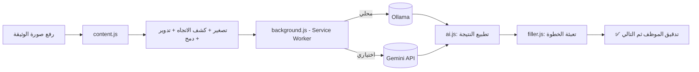

<div align="center">


# Nazeel | نزيل

**إحصائيات النزلاء + مساعد إدخال ذكي للفنادق — إضافة Chrome (Manifest V3)**
*Guest analytics + AI-assisted guest registration for hotels — Chrome Extension (MV3)*


[العربية](#-العربية) · [English](#-english) · [الخصوصية](PRIVACY.md) · [الأمان](SECURITY.md) · [سجل التغييرات](CHANGELOG.md)

</div>

---

## 🇮🇶 العربية

### ما هي «نزيل»؟
إضافة لمتصفح Chrome تساعد موظف الاستقبال على أمرين:

1. **إحصائيات النزلاء** — تحلل صفحة النزلاء وتعرض: العدد الكلي، الجدد والقدامى، العراقيون والأجانب، الجنسيات، الطوابق والغرف، الأعمار، مدة الإقامة، مع تنبيهات (أسماء مكررة، غرف مزدحمة، قاصرون).
2. **مساعد الإدخال الذكي** — يقرأ صور **الهوية الوطنية، الجواز، التأشيرة** (أي دولة) بالذكاء الاصطناعي، ويعبّي استمارة «إضافة نزيل» **للمراجعة**؛ الموظف هو من يدقق ويضغط «التالي».

### 💡 ما الفائدة؟
| المشكلة اليومية في الاستقبال | كيف تحلّها «نزيل» |
|---|---|
| إدخال بيانات الهوية/الجواز يدوياً حقلاً بعد حقل، وفيه أخطاء إملائية وأرقام خاطئة | قراءة الوثيقة بالذكاء الاصطناعي ثم **التحقق من MRZ بأرقام التحقق (ICAO 9303)** لتصحيح رقم الجواز وتاريخ الميلاد والجنسية |
| الجوازات الأجنبية بأبجديات مختلفة وأسماء متعددة الأجزاء | توحيد الأسماء لاتينياً وتوزيعها على حقول المنظومة واختيار الاستمارة (عراقي/أجنبي) تلقائياً |
| صور مقلوبة أو عدة صفحات للوثيقة الواحدة | تدوير تلقائي ودمج الصور في صورة واحدة قبل القراءة |
| سؤال الإدارة اليومي: «كم نزيل؟ كم أجنبي؟ أي الغرف مزدحمة؟» | لوحة إحصائيات فورية + تقرير واتساب + CSV + تقرير للطباعة |
| الخوف على خصوصية النزلاء | الوضع الافتراضي **محلي بالكامل**، لا تتبع ولا خادم وسيط، والإضافة لا تعمل إلا على موقع تفعّله بنفسك |
| الثقة بالأتمتة | **لا تضغط «التالي» ولا تُرسل نيابةً عنك**: كل حقل مُعبّأ يُلوَّن (موثوق / يحتاج مراجعة / ناقص) ويدقّقه الموظف |

### ✨ المزايا

| الميزة | التفاصيل |
|---|---|
| 📊 لوحة إحصائيات | ملخص، جنسيات، غرف، نزلاء — مع فلاتر (`305` / `301-308` / `3*`) |
| 📱 نسخ للواتساب | تقرير نصي منسق بضغطة واحدة |
| 🧾 تقرير كامل | صفحة قابلة للطباعة / حفظ PDF |
| 📤 تصدير CSV | بترميز UTF-8 متوافق مع Excel |
| 🪪 قراءة الوثائق | هوية (وجه/ظهر)، جواز، تأشيرة، تأشيرة إلكترونية عراقية |
| 🔄 تدوير تلقائي | يصحح الصور المقلوبة قبل القراءة |
| 🧩 دمج الصور | يدمج عدة صور في صورة واحدة قبل التحليل |
| 🌍 كل الدول | يختار الدولة ونوع الاستمارة (عراقي/أجنبي) تلقائياً |
| 🔒 خصوصية أولاً | الوضع الافتراضي **محلي بالكامل** عبر Ollama |
| ☁️ Gemini اختياري | أسرع وأدق، مع تحذير صريح قبل إرسال أي صورة |

### 🏗️ كيف تعمل؟



### 📦 التثبيت

**للمستخدم (من الإصدارات):**
1. نزّل `nazeel-vX.Y.Z.zip` من صفحة [Releases](../../releases) وفك الضغط.
2. افتح `chrome://extensions` وفعّل **وضع المطوّر**.
3. اضغط **تحميل إضافة غير مضغوطة** واختر المجلد.
4. افتح صفحة المنظومة، ثم افتح لوحة **مساعد الإدخال** واضغط **«تفعيل على هذا الموقع»** ووافق على الإذن. (مرة واحدة لكل موقع؛ تستطيع إلغاءه متى شئت.)

**للمطوّر:**
```bash
git clone https://github.com/AliAI-spirt/nazeel.git
cd nazeel
npm ci
npm run verify   # فحص المانيفست والإصدارات والأسرار + الاختبارات الآلية
npm run build    # ينتج dist/nazeel-vX.Y.Z.zip و SHA256SUMS.txt
npm run bump -- 5.3.0   # رفع الإصدار في كل الملفات دفعة واحدة
```
ثم حمّل مجلد `src/` كإضافة غير مضغوطة.

### 🤖 إعداد الذكاء الاصطناعي

**الخيار 1 — محلي (موصى به للخصوصية):**
```bash
# ثبّت Ollama من https://ollama.com ثم:
ollama pull qwen3-vl:4b-instruct
```
افتح لوحة الإضافة ← *مساعد الإدخال* ← *إعدادات الذكاء* ← **اختبار الاتصال**.

**الخيار 2 — Google Gemini (سحابي):**
احصل على مفتاح من [AI Studio](https://aistudio.google.com/apikey) والصقه في الإعدادات. تُرسل الصور إلى Google — اقرأ [PRIVACY.md](PRIVACY.md) أولاً.

### 🔐 الأذونات ولماذا نحتاجها

| الإذن | السبب |
|---|---|
| `storage` | حفظ الإعدادات والبيانات المحللة على جهازك فقط |
| `activeTab` + `scripting` | قراءة صفحة النزلاء وتعبئة الاستمارة عند طلبك |
| `sidePanel` | عرض مساعد الإدخال |
| `declarativeNetRequest` | إزالة ترويسة `Origin` لطلبات Ollama المحلية |
| وصول **اختياري** لموقع واحد | يُطلب فقط عند ضغطك «تفعيل على هذا الموقع»، لموقع المنظومة وحده، وتستطيع سحبه في أي وقت |
| `localhost:11434` | الاتصال بـ Ollama المحلي |

### 🗂️ هيكل المشروع
```
nazeel/
├─ src/                 # كود الإضافة (يُحمَّل في Chrome)
│  ├─ manifest.json
│  ├─ background.js     # Service Worker: طلبات الذكاء
│  ├─ site.js           # تفعيل الإضافة على موقع المنظومة فقط (أقل صلاحيات)
│  ├─ content.js        # يلتقط رفع الصور داخل المنظومة
│  ├─ filler.js         # تعبئة حقول الاستمارة
│  ├─ ai.js             # Ollama / Gemini + تطبيع النتائج
│  ├─ imaging.js        # تصغير/تدوير/دمج الصور
│  ├─ countries.js      # بيانات الدول والرموز
│  ├─ analysis.js       # مكتبة الإحصائيات المشتركة
│  ├─ popup.*           # النافذة المنبثقة
│  ├─ assistant.*       # اللوحة الجانبية
│  └─ report.*          # التقرير الكامل
├─ test/                # اختبارات آلية (node:test): MRZ، التطبيع، الفلاتر، CSV
├─ docs/                # شعار وصور ودلائل
├─ store/               # نصوص صفحة المتجر
├─ scripts/             # أدوات البناء والفحص
└─ .github/             # قوالب القضايا وسير العمل
```

### 🧭 خارطة الطريق
- [x] تقييد الإضافة على موقع المنظومة فقط (v5.2.0)
- [x] اختبارات آلية لتطبيع الوثائق وMRZ (v5.2.0)
- [ ] لقطة يومية تلقائية للإحصائيات (`chrome.alarms`) مع مخطط اتجاه الإشغال — بدون بيانات شخصية
- [ ] كشف تكرار النزيل وتنبيه الوثائق المنتهية/القريبة الانتهاء قبل الحفظ
- [ ] مؤشر ثقة لكل حقل (مقروء من MRZ / من الذكاء فقط / غير مؤكد)
- [ ] تشفير مفتاح Gemini بعبارة مرور يدخلها المستخدم (أو تخزينه في الذاكرة فقط لكل جلسة)
- [ ] دعم تسجيل الدخول للمجموعات (عدة فنادق)
- [ ] واجهة إنكليزية كاملة

### 🤝 المساهمة
نرحب بالمساهمات — راجع [CONTRIBUTING.md](CONTRIBUTING.md). للإبلاغ عن ثغرة أمنية اقرأ [SECURITY.md](SECURITY.md).

### ⚠️ إخلاء مسؤولية
الأداة **مساعِدة** وليست بديلاً عن التدقيق البشري. المستخدم مسؤول عن صحة البيانات المسجلة وعن الالتزام بأنظمة بلده وسياسة فندقه في حماية بيانات النزلاء.

---

## 🇬🇧 English

**Nazeel** is a Manifest V3 Chrome extension for hotel front desks with two parts:

- **Guest analytics** — occupancy, new vs. returning guests, Iraqi vs. foreign, nationalities, floors/rooms, ages, length of stay, plus data-quality alerts. Export to CSV, WhatsApp text, or a printable report.
- **Smart Entry Assistant** — reads national IDs, passports and visas from any country using a **local model (Ollama)** or **Google Gemini**, auto-rotates upside-down scans, merges multi-page images, and pre-fills the guest form **for human review**. It never submits on your behalf.

### Quick start
```bash
git clone https://github.com/AliAI-spirt/nazeel.git && cd nazeel
npm run check && npm run build
# chrome://extensions → Developer mode → Load unpacked → select ./src
ollama pull qwen3-vl:4b-instruct   # local, private OCR
```

### Privacy at a glance
- Default engine is **fully local**; nothing leaves the machine.
- Gemini is **opt-in** and shows an explicit warning; images are sent to Google.
- No analytics, no telemetry, no remote code. See [PRIVACY.md](PRIVACY.md).

### License
[MIT](LICENSE) © SpiritTECH  contributors
