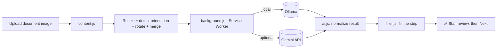

<div align="center">


# Nazeel | نزيل

**Guest analytics + AI-assisted guest registration for hotels**
*A Chrome extension (Manifest V3)*


[Privacy](PRIVACY.md) · [Security](SECURITY.md) · [Changelog](CHANGELOG.md) · [Contributing](CONTRIBUTING.md)

</div>

---

## What is Nazeel?

Nazeel is a Chrome extension that helps hotel front-desk staff with two daily tasks:

1. **Guest analytics** – analyzes the guests page and shows total guests, new vs. returning, Iraqi vs. foreign, nationalities, floors and rooms, ages and length of stay, with data-quality alerts (duplicate names, crowded rooms, minors).
2. **Smart Entry Assistant** – reads photos of **national IDs, passports and visas** (from any country) with AI and pre-fills the "Add guest" form **for human review**. The staff member checks every field and clicks "Next" themselves.

> **Note:** the extension's user interface is currently in Arabic (right-to-left). A full English interface is on the roadmap.

## Why use it?

| Everyday front-desk problem | How Nazeel helps |
|---|---|
| Typing ID/passport data field by field causes typos and wrong numbers | AI reads the document, then **MRZ check-digit validation (ICAO 9303)** corrects the passport number, date of birth and nationality |
| Foreign passports use different scripts and multi-part names | Names are normalized to Latin letters, split into the system's fields, and the correct form (Iraqi / foreign) is selected automatically |
| Upside-down photos or several pages for one document | Automatic rotation and merging of images into one before reading |
| Management asks daily: "How many guests? How many foreigners? Which rooms are crowded?" | Instant statistics dashboard + WhatsApp report + CSV + printable report |
| Worry about guest privacy | **Fully local by default**, no tracking, no middle server, and the extension only runs on a site you enable yourself |
| Trust in automation | It **never clicks "Next" or submits for you**: every filled field is color-coded (trusted / needs review / missing) and verified by staff |

## Features

| Feature | Details |
|---|---|
| 📊 Statistics dashboard | Summary, nationalities, rooms, guests – with filters (`305` / `301-308` / `3*`) |
| 📱 WhatsApp copy | A formatted text report in one click |
| 🧾 Full report | Printable page / save as PDF |
| 📤 CSV export | UTF-8 with BOM for Excel; spreadsheet formulas are neutralized |
| 🪪 Document reading | ID (front/back), passport, visa sticker, Iraqi e-Visa |
| 🔄 Auto-rotation | Fixes upside-down images before reading |
| 🧩 Image merging | Combines several images into one before analysis |
| 🌍 All countries | Picks the country and form type (Iraqi / foreign) automatically |
| 🔒 Privacy first | Default engine is **fully local** through Ollama |
| ☁️ Optional Gemini | Faster and more accurate, with an explicit warning before any image is sent |

## How it works



## Installation

**For users (from Releases):**
1. Download `nazeel-vX.Y.Z.zip` from the [Releases](../../releases) page and unzip it into a permanent folder.
2. Open `chrome://extensions` and turn on **Developer mode**.
3. Click **Load unpacked** and select the folder.
4. Open the hotel system page, open the **Entry Assistant** side panel, click **"Enable on this site"** (in Arabic) and approve the permission. This is done once per site and can be revoked at any time.

**For developers:**
```bash
git clone https://github.com/AliAI-spirt/nazeel.git
cd nazeel
npm ci
npm run verify          # manifest, versions, secret scan + automated tests
npm run build           # produces dist/nazeel-vX.Y.Z.zip and SHA256SUMS.txt
npm run bump -- 5.3.0   # bump the version everywhere in one step
```
Then load the `src/` folder as an unpacked extension.

## AI setup

**Option 1 – Local (recommended for privacy):**
```bash
# Install Ollama from https://ollama.com, then:
ollama pull qwen3-vl:4b-instruct
```
Open the extension panel → *Entry Assistant* → *AI settings* → **Test connection**.

**Option 2 – Google Gemini (cloud):**
Get a key from [AI Studio](https://aistudio.google.com/apikey) and paste it into the settings. Images are sent to Google – read [PRIVACY.md](PRIVACY.md) first.

## Permissions and why they are needed

| Permission | Reason |
|---|---|
| `storage` | Save settings and analyzed data on your device only |
| `activeTab` + `scripting` | Read the guests page and fill the form when you ask |
| `sidePanel` | Show the Entry Assistant |
| `declarativeNetRequest` | Remove the `Origin` header for local Ollama requests |
| **Optional** access to one site | Requested only when you click "Enable on this site", for the hotel system alone, and you can revoke it at any time |
| `localhost:11434` | Connect to local Ollama |

## Project structure

```
nazeel/
├─ src/                 # extension code (loaded into Chrome)
│  ├─ manifest.json
│  ├─ background.js     # Service Worker: AI requests
│  ├─ site.js           # enable the extension on the hotel site only (least privilege)
│  ├─ content.js        # captures image uploads inside the hotel system
│  ├─ filler.js         # fills the form fields
│  ├─ ai.js             # Ollama / Gemini + result normalization
│  ├─ imaging.js        # resize / rotate / merge images
│  ├─ countries.js      # country data and codes
│  ├─ analysis.js       # shared statistics library
│  ├─ popup.*           # popup window
│  ├─ assistant.*       # side panel
│  └─ report.*          # full report
├─ test/                # automated tests (node:test): MRZ, normalization, filters, CSV
├─ docs/                # logo, images, guides
├─ store/               # store listing texts
├─ scripts/             # build and check tools
└─ .github/             # issue templates and workflows
```

## Roadmap

- [x] Restrict the extension to the hotel system site only (v5.2.0)
- [x] Automated tests for document normalization and MRZ (v5.2.0)
- [ ] Automatic daily statistics snapshot (`chrome.alarms`) with an occupancy trend chart – no personal data
- [ ] Duplicate-guest detection and expired / soon-to-expire document alerts before saving
- [ ] Per-field confidence indicator (read from MRZ / AI only / unverified)
- [ ] Encrypt the Gemini key with a user passphrase (or keep it in memory only, per session)
- [ ] Multi-hotel (group) sign-in support
- [ ] Full English interface

## Contributing

Contributions are welcome – see [CONTRIBUTING.md](CONTRIBUTING.md). To report a security vulnerability, read [SECURITY.md](SECURITY.md).

## Privacy at a glance

- The default engine is **fully local**; nothing leaves the machine.
- Gemini is **opt-in** and shows an explicit warning; images are sent to Google.
- The extension runs only on the one site you enable.
- No analytics, no telemetry, no remote code. See [PRIVACY.md](PRIVACY.md).

## Disclaimer

This tool is an **assistant**, not a replacement for human verification. The user is responsible for the accuracy of the recorded data and for complying with local regulations and the hotel's guest-data protection policy.

## License

[MIT](LICENSE) © SpiritTECH contributors